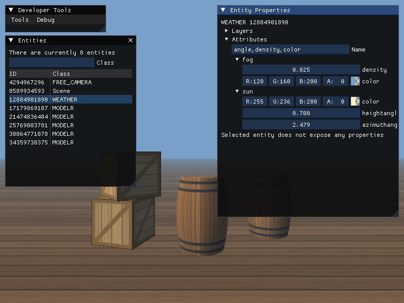
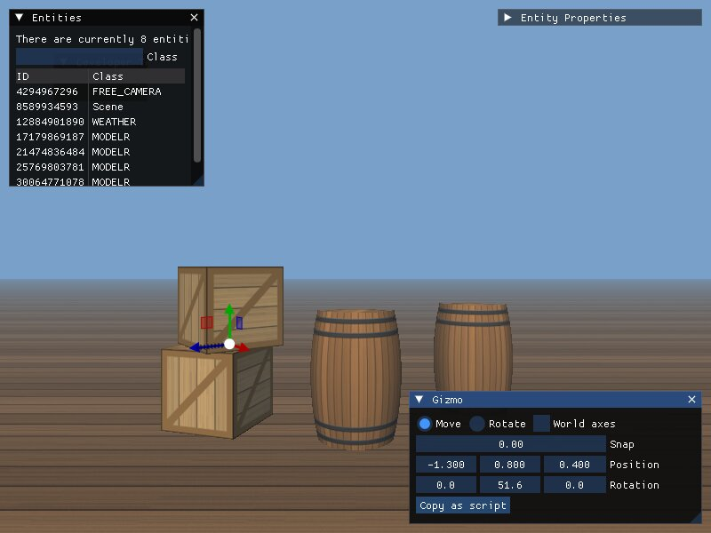
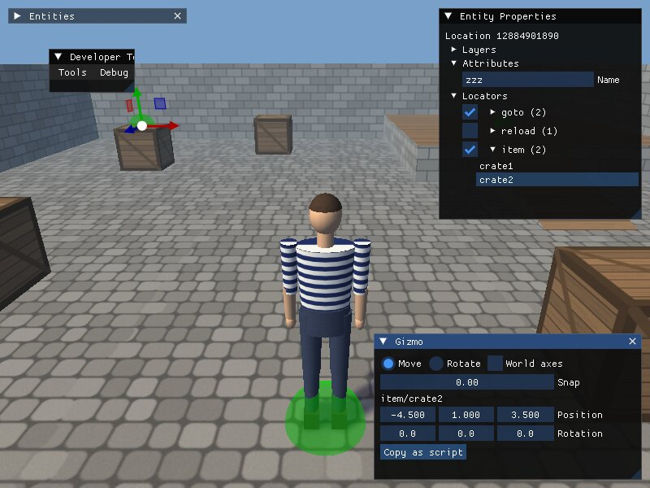
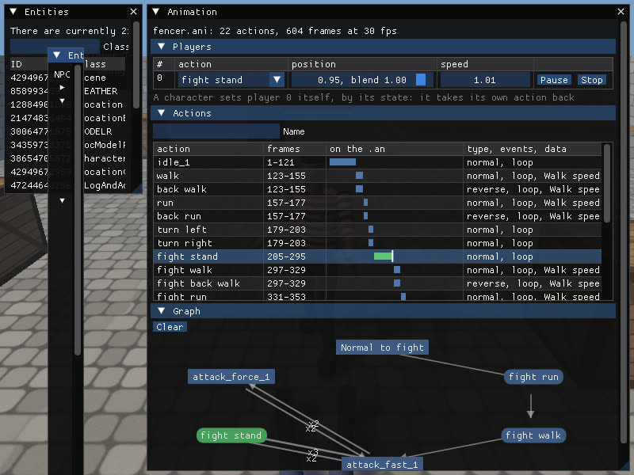

# Storm Editor

Окна инструментов встроенного редактора [Storm Engine](https://github.com/POMXARK/storm-engine) (ветка `miniaudio-sound`): движок запускается с `--editor`, поверх кадра открывается ImGui. Работает на Windows и Linux (d3d9 через dxvk-native).



## Окна

| Окно | Что делает |
|---|---|
| Entities | все сущности движка с классом, фильтр по классу |
| Entity Properties | слои и приоритеты выбранной сущности, дерево её атрибутов с правкой на лету: числа тянутся мышью, цвета `argb` — палитрой, текст — по Enter; правка доходит до сущности через `AttributeChanged`, как присваивание из скрипта |
| Gizmo | двигает и поворачивает выбранную модель или локатор локации (ветка **Locators** в Entity Properties) гизмо ImGuizmo в кадре или числами, оси модели или мира, шаг; **Copy as script** — строка `MSG_MODEL_SET_POSITION` для скрипта (в буфер и в `compile.log`) |
| Animation | анимация выбранной модели или персонажа (`EngineEditor::ModelOf`): проигрыватели с действием, позицией, скоростью и Play/Pause/Stop; действия .ani полосами на кадрах .an с событиями и данными, щелчок играет действие; граф переходов, увиденных пока окно открыто |





Для локатора **Copy as script** даёт метку генератора (`("item", "crate2", (x, y, z), (dx, dz)),`). Свой объект для гизмо модуль движка отдаёт через `EngineEditor::SetGizmoTarget` — так это делает `Location::ShowEditor`.



Модуль, у сущности которого модель лежит внутри (персонаж), сообщает о ней через `EngineEditor::RegisterModelOf`, тогда Animation и другие окна находят модель по выбранной сущности.

Дальше: окна игровых данных.

## Подключение

Репозиторий — submodule движка в `src/libs/editor_tools`, собирается как его модуль:

```bash
git submodule update --init src/libs/editor_tools
cmake ../storm-engine -G Ninja -DCMAKE_BUILD_TYPE=Debug     # -DSTORM_EDITOR_TOOLS=OFF — без окон
```

Без submodule (или с `STORM_EDITOR_TOOLS=OFF`) движок собирается и работает как прежде, в оверлее остаются меню Debug и окна самих модулей.

## Своё окно

Модули движка линкуются целиком, поэтому окно регистрирует себя само:

```cpp
#include "storm/editor/engine_editor.hpp"

namespace
{
void ShowMyTool(bool &active)
{
    if (ImGui::Begin("My Tool", &active))
    {
        // ...
    }
    ImGui::End();  // и для свёрнутого окна
}

[[maybe_unused]] const bool registered = [] {
    storm::editor::EngineEditor::RegisterEditorTool("My Tool", ShowMyTool);
    return true;
}();
}
```

Состояние между запусками — в `imgui.ini` рабочей папки, секция `[Storm][Editor]`: открытые окна (`Open=`) и значения окон (`EngineEditor::SetSetting/GetSetting`, например `Entities.Class=`, `Entities.Index=`, `Gizmo.Operation=`, `Animation.Filter=`). Так редактор проверяется без нажатий: тест кладёт `imgui.ini` и снимает окно.

Движок отдаёт редактору только общий API `core` (`ForEachEntity`, `GetClassCode`, `GetLayerPriority`, атрибуты сущностей) и `Entity::ShowEditor()` — поля, которые класс показывает сам.

## Лицензия

GPL-3.0, как и движок. ImGuizmo (MIT) приходит из Conan движка.
